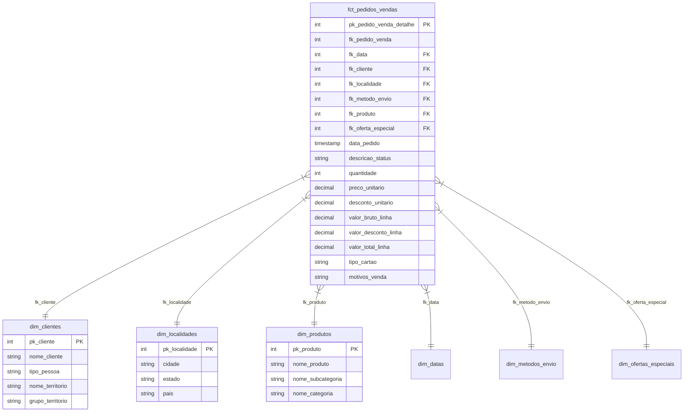

# CEA-AW: Analytics Engineering Pipeline - Adventure Works

Este projeto implementa um pipeline completo de Analytics Engineering utilizando dados da empresa fictícia Adventure Works. O pipeline engloba desde a extração de dados transacionais, transformação via dbt com arquitetura em camadas (Medallion / Dimensional), até a orquestração utilizando Databricks Asset Bundles (DABs).

## Arquitetura e Stack Tecnológica

O projeto foi construído usando as seguintes ferramentas:
- **PostgreSQL**: Serviu como banco de dados transacional (OLTP) de origem, simulando um ambiente produtivo. Suas tabelas foram exportadas para arquivos CSV, que são carregados no Databricks como tabelas Delta no schema `adventure_works`.
- **Databricks (Lakehouse)**: Plataforma principal de processamento e armazenamento (Delta Lake).
- **dbt (Data Build Tool)**: Ferramenta responsável pela modelagem, transformação e testes de qualidade de dados.
- **Databricks Asset Bundles (DABs)**: Ferramenta de orquestração CI/CD (Infrastructure as Code) para deploy de jobs no Databricks.

## Modelagem de Dados

Optamos por uma modelagem dimensional estruturada nas seguintes camadas, respeitando as melhores práticas do dbt:

1. **Staging (Bronze/Raw):**
   - Importação direta das tabelas fonte (`adventure_works`), renomeando as colunas para um formato padronizado (snake_case e em Português) e fazendo o cast explícito de tipos de dados.
   - Aplicação de testes de integridade básica (`unique`, `not_null`) em chaves primárias.

2. **Intermediate (Prata/Silver):**
   - Junções (JOINs) entre entidades altamente normalizadas (ex: `Customer` + `Person` + `SalesTerritory`, `Address` + `StateProvince` + `CountryRegion`).
   - Geração de uma espinha dorsal de datas (Date Spine) construída dinamicamente.
   - Desnormalização e agregação (ex: concatenar múltiplos motivos de venda num mesmo pedido).

3. **Marts (Ouro/Gold):**
   - Criação do **Star Schema** focado nas análises de vendas, expondo Views/Tables amigáveis ao negócio:
     - Fatos: `fct_pedidos_vendas` (com as chaves estrangeiras, métricas de negócio, tipos de cartão e motivos agregados).
     - Dimensões: `dim_clientes` (com território de vendas), `dim_localidades` (cidade, estado e país do endereço de entrega do pedido), `dim_produtos` (com categorias e subcategorias), `dim_datas`, `dim_metodos_envio`, `dim_ofertas_especiais`.
   - A localização vem do endereço de entrega do pedido, e não do cadastro do cliente: clientes do tipo loja não possuem endereço pessoal, enquanto todo pedido possui endereço de entrega.

### Diagrama do Modelo Dimensional (Star Schema)



## Qualidade e Testes de Dados

Para garantir a confiabilidade analítica, implementamos:
- Testes genéricos (chaves primárias únicas e não nulas).
- Relacionamentos mapeados no arquivo `_marts.yml` da camada Marts garantindo a Integridade Referencial.
- **Auditoria de Negócio (Singular Test):** Teste contábil auditando que o valor total de vendas brutas (Gross Sales) no ano de 2011 resultou exatamente no montante validado de **$12,646,112.16**.

## Como Executar o Projeto

1. **Simulação do banco de origem (ingestão dos CSVs):**
   O objetivo desta etapa é simular o banco de dados transacional da Adventure Works dentro do Databricks a partir de arquivos CSV. No projeto, as tabelas foram exportadas do PostgreSQL para CSV (com o comando `\copy` do `psql`); quem for reproduzir o projeto não precisa de um servidor PostgreSQL, basta ter os CSVs. Cada CSV corresponde a uma tabela do sistema de origem, e o schema `workspace.adventure_works` passa a ser a fonte (`source`) do dbt. São usadas 18 tabelas:
   `Address`, `BusinessEntityAddress`, `CountryRegion`, `CreditCard`, `Customer`, `Person`, `PersonCreditCard`, `Product`, `ProductCategory`, `ProductSubcategory`, `SalesOrderDetail`, `SalesOrderHeader`, `SalesOrderHeaderSalesReason`, `SalesReason`, `SalesTerritory`, `ShipMethod`, `SpecialOffer` e `StateProvince`.

   O processo tem três passos:
   - Criar o schema e um Volume para receber os arquivos:
     ```bash
     databricks schemas create adventure_works workspace
     databricks volumes create workspace adventure_works raw_data MANAGED
     ```
   - Enviar os CSVs para o Volume com a CLI do Databricks:
     ```bash
     databricks fs cp <pasta_com_os_csvs>/ dbfs:/Volumes/workspace/adventure_works/raw_data/ --recursive --overwrite
     ```
   - Criar uma tabela Delta para cada CSV no SQL Editor do Databricks, com o nome da tabela em minúsculas (exemplo para uma das tabelas; repita para as demais):
     ```sql
     CREATE OR REPLACE TABLE workspace.adventure_works.salesorderheader
     AS SELECT * FROM read_files(
       '/Volumes/workspace/adventure_works/raw_data/SalesOrderHeader.csv',
       format => 'csv', header => true, inferSchema => true
     );
     ```

2. **Deploy do Bundle:**
   Faça o deploy do código para o Databricks utilizando a CLI do Databricks:
   ```bash
   databricks bundle deploy --target dev
   ```

3. **Execução do Job (dbt build):**
   Rode o job do dbt remotamente no serverless SQL do Databricks:
   ```bash
   databricks bundle run cea_aw_dbt_job --target dev
   ```

## Análise Exploratória (EDA)

O notebook `bundles/cea_aw_dbt/src/eda_adventure_works.py` (formato de notebook Databricks) é enviado ao workspace pelo `databricks bundle deploy` e roda em serverless com *Run all*. Ele só lê dados (`workspace.adventure_works` e `workspace.dev_cea_aw_marts`) e usa as mesmas definições de indicadores do dashboard. Cada gráfico ou tabela vem seguido de um comentário com o insight:
- **Qualidade dos dados:** chaves íntegras, pedidos sem cartão (N/A), pedidos sem motivo de venda (Nenhum), status único e o motivo de a localização vir do endereço de entrega.
- **Auditoria:** reproduz o valor de 2011 (US$ 12.646.112,16) e mostra por que o preço precisa de 4 casas decimais.
- **Tempo:** evolução mensal por canal, comparação entre períodos equivalentes (2014 está incompleto), o ciclo mensal de pedidos da revenda e as trocas de catálogo de bicicletas no online.
- **Canais, produtos, locais e clientes:** efeito de mix no ticket médio, Pareto e curva ABC de produtos e clientes, recorrência de clientes e o efeito real do motivo "Promotion".
- **Conclusões:** decisões de modelagem que vieram da análise e recomendações para o negócio.

## Regras de Negócio

O documento [`docs/regras_de_negocio.md`](docs/regras_de_negocio.md) reúne as perguntas de negócio, a definição de cada indicador (pedidos, valor total negociado, valor líquido, ticket médio, Pareto e curva ABC), as regras de tratamento dos dados (localização pelo endereço de entrega, cartão N/A, motivo "Nenhum", precisão do preço) e os valores de referência usados para conferir o painel, o notebook e os testes do dbt.

## Dashboard de Negócios

Com as tabelas consolidadas geradas pela camada Marts no schema `dev_cea_aw_marts`, o dashboard atende às necessidades dos diretores e partes interessadas, fornecendo métricas estratégicas, como:
- Número de pedidos, quantidade comprada e valor total negociado.
- Análise de tickets médios (mensal, mensal por canal e anual por país).
- Top 20 produtos, Top 20 estados, Top 10 clientes e Top 5 cidades com mais faturamento.
- Top 20 produtos por ticket médio (por mês, ano e localização, por meio dos filtros).
- Série temporal mensal de faturamento, pedidos e quantidade comprada.
- Produtos mais vendidos com o motivo de venda "Promotion".

O dashboard foi organizado como uma narrativa: cada página responde a uma pergunta e cada seção a uma pergunta menor. **Visão geral** (como está o negócio: indicadores, evolução mensal do faturamento explicada por pedidos × ticket médio, participação por canal e categoria), **Análise por dimensão** (o que, onde e para quem vendemos: produtos, localização, clientes, motivo de venda, tipo de cartão e status) e **Análises avançadas** (por quê: Pareto de produtos e de clientes em barras + linha acumulada, curva ABC de produtos, efeito do motivo "Promotion" e dos descontos, papel de cada canal e recorrência de clientes). Os filtros são globais e valem para todas as páginas: período, produto, cliente, tipo de cartão, motivo de venda, status, cidade, estado, país e canal de venda. Todos os gráficos respondem a todos os filtros. Os rankings (Top 20 produtos, Top 20 produtos por ticket médio, Top 20 estados, Top 10 clientes, Top 5 cidades e produtos do motivo "Promotion") e as curvas de Pareto são calculados na própria consulta SQL (agrupamento + limite), então cada filtro chega neles como um parâmetro da consulta, aplicado antes do agrupamento: o ranking é recalculado para a seleção, e não apenas recortado. A definição do dashboard é versionada em `bundles/cea_aw_dbt/src/cea_aw_dashboard.lvdash.json` e publicada pelo `databricks bundle deploy`.
